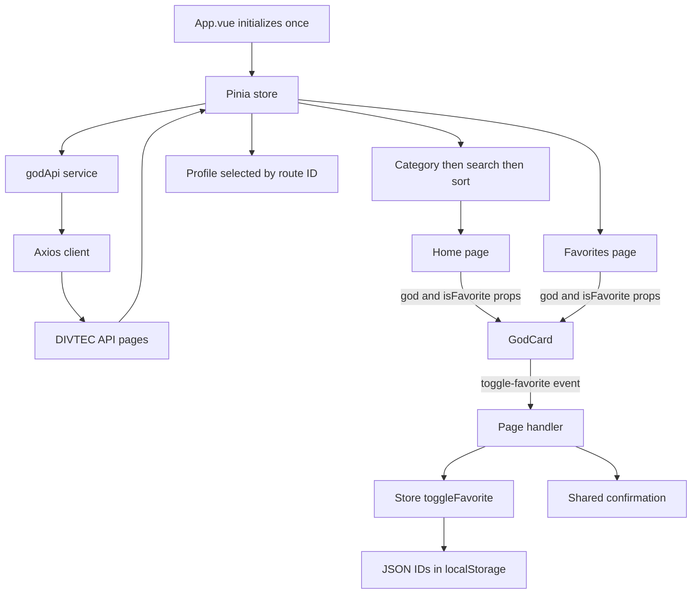

# Greek Gods

[Live application on Vercel](https://294-projet-dieu-grec-segalor.vercel.app/) · [GitHub Pages](https://loris-seganfredo.github.io/294-projet-dieuGrec-segalor/) · [Source code](https://github.com/Loris-seganfredo/294-projet-dieuGrec-segalor)

This Vue 3 and Vuetify project follows the [individual assessment brief](https://tirtho.notion.site/Projet-individuel-valuatif-Application-Vue-3-Vuetify-avec-API-268e74c07f7c80e5822adb530f7a6027) and the DEV JS exercises through **sequence 5, steps 1–17**. The interface and content are in English. Forms, authentication and API mutations from later sequences are outside this delivery.

## 1. Project presentation

### Concept

Greek Gods is a reference catalog for students and visitors discovering mythology. Visitors can find a deity, read its profile and save a personal selection. The public DIVTEC API provides names, categories, descriptions, portraits and relationships without an API key.

The project adapts the course's Pokémon examples to Greek mythology. The reason for choosing this subject is explained in section 6.

### Main features

- A responsive catalog with portraits, names and descriptions.
- Case-insensitive name search, category filtering and A–Z/Z–A sorting.
- Detailed profiles, an About page and unknown-page handling.
- Favorites with immediate visual feedback and browser persistence.
- Loading indicators, network errors with retry and empty-state messages.
- A default Greek temple illustration for missing or failed portraits.
- Keyboard focus indicators and contrasting colors for light and dark system themes.

### Screenshots


[Mobile screenshot](docs/screenshots/home-mobile.png) · [Dark theme screenshot](docs/screenshots/home-dark.png)

## 2. Learning path

### Resources

The main learning material is the [DEV JS Pokédex exercise](https://devjs.ch/exercices/pokedex-vuetify/e1.html), adapted to the Greek API. Official Vue, Vuetify, Pinia, Vue Router and Axios documentation supports the implementation. Links are collected in section 7.

### Recorded progression

The dates below come from Git. They show the project's development, rather than proving individual learning or attendance at weekly meetings.

| Date | Recorded work |
| --- | --- |
| 22 September 2026 | Initial project skeleton. |
| 20 October | Pinia store, list/detail integration, complete API pagination and GitHub Pages base path. |
| 26 October | Axios configuration, environment variables, loading indicators and error handling. |
| 2 November | Search, category filter, alphabetical sorting and persistent favorites. |
| 3 November | English interface, routing fixes, fallback images, exercise audit, then comparison with the actual assessment brief. Props/emits, API service separation, contrast and keyboard focus were improved. |

The student's own account of resources studied, difficult concepts and progress is still to be supplied. Weekly teacher meetings are required by the brief; the repository does not establish whether they took place.

## 3. Tools and methodology

### Environment

- Vue 3, Vuetify 3, Pinia, Vue Router, Axios and Vite.
- npm for dependency installation; ESLint for code checks.
- Git and GitHub for version history; Vercel and GitHub Pages for publication.
- OpenAI Codex desktop for the assisted implementation, review and testing described in section 5.

### Installation and run

Use Node.js 22 or later:

```sh
git clone https://github.com/Loris-seganfredo/294-projet-dieuGrec-segalor.git
cd 294-projet-dieuGrec-segalor
npm ci
npm run dev
```

Vite normally starts at `http://localhost:3000/`. Use the URL printed in the terminal if that port is occupied. Stop it with `Ctrl+C`. A separate API server is not needed.

To change the API address, copy `.env.example` to `.env`, set `VITE_API_URL` and restart Vite. The default is `https://apis.divtec.me/api/greek`. No API key is required. `.env` is ignored by Git; `.env.example` is tracked. Variables starting with `VITE_` are public in the browser bundle and must not contain secrets.

```sh
npx eslint .
npm run build
npm run preview
```

`npm run lint` also applies automatic ESLint fixes.

### Components, props and events

`GodCard` receives two required props: `god` and `isFavorite`. It emits `toggle-favorite` with the selected god. The home and favorites pages handle that event through `useFavoriteFeedback()`, which calls the store action and updates the shared snackbar state. There is no global event bus.

The heart uses `@click.stop.prevent`: `.stop` stops propagation to the card and `.prevent` cancels the linked card's default navigation. The detail page uses the same favorite handler. `GodImage` is reused for portraits and fallback illustrations. `AppFooter` receives its text through a slot.

### API choices and limits

| Resource used | Purpose |
| --- | --- |
| `GET https://apis.divtec.me/api/greek/gods?page=1` | Load the first page and read the page count. |
| `GET /gods?page=2`, then subsequent pages on the same base | Load the entire catalog before updating the store. |
| Image paths from the response, resolved against `https://apis.divtec.me` | Load portraits. |

The response contains `data` and `pagination`. During verification it contained 51 entries over three pages. The count is not hard-coded. Categories are derived from the loaded objects; detail pages use the store's `getGodById()` instead of making another request.

Requests have a ten-second timeout. No API quota guarantee has been verified. A failed request produces an error with a retry button. No partial catalog is published after a failed page. Favorites are cleaned only after every API page succeeds.

The brief explicitly waives the mock/offline requirement for **2026–2027**. This application therefore displays an honest error instead of silently substituting fictional data.

### Architecture and data flow

| Location | Responsibility |
| --- | --- |
| `src/plugins/axios.js` | Shared Axios client and environment configuration. |
| `src/services/godApi.js` | HTTP requests, response validation and pagination. |
| `src/stores/godStore.js` | Shared state, getters, initialization and favorite persistence. |
| `src/pages/` | Home, detail, favorites, About and not-found views. |
| `src/components/` | Reusable card, image, header and footer. |
| `src/composables/favoriteFeedback.js` | Favorite action with shared confirmation feedback. |
| `src/plugins/vuetify.js`, `src/styles/` | Theme colors, keyboard focus and animation. |



The computed chain derives a view of the store. Sorting uses a copied array, so it cannot reorder the source. Favorites store numeric IDs, not entire objects. `JSON.stringify()` writes them under `god_favorites`; `JSON.parse()` restores them.

### Versioning and publication

Work is committed by feature or correction and pushed to `main`. The 2026–2027 brief explicitly permits using `main` without weekly milestone branches. The historical commits have been preserved.

GitHub Pages builds with the repository base path. Hash routes such as `/#/gods/1` support direct access and reloading on static hosting. The deployment script keeps older clean URLs working through redirects; `/favoris` remains an alias for `/favorites`.

## 4. Tests and validation

The [assessment audit](docs/assessment-audit.md) maps the actual brief to evidence and records remaining personal requirements. The [earlier exercise audit](docs/exam-audit.md) covers the sequence 1–5 baseline only.

The verification covers:

- Complete real-API loading, pagination, malformed responses, partial failure and retry.
- Search, filter and sort combinations without mutating source data.
- Card navigation, favorite events, persistence after reload and removal of the last favorite.
- Keyboard activation with Tab, Enter and Space; visible focus on navigation, cards, buttons and fields.
- Text and control contrast in light and dark themes, including tonal messages.
- Mobile and desktop layouts, missing images, invalid IDs and unknown pages.
- ESLint, production build, deployment status and the running public pages.

The API service/store and shared favorite feedback were also checked with isolated Node scripts using the actual sources, real Vue/Pinia and simulated API/storage. These checks were assisted by Codex; they are not claimed as tests personally written or performed by the student.

## 5. Use of artificial intelligence

### Tool and context

OpenAI Codex was used through the desktop application for implementation, explanations, debugging, source review, documentation and tests. Exact model versions used throughout earlier sessions were not recorded. Reliable authorship percentages are not available, so no percentages are invented.

### Assistance and adaptation

| Area | Assistance provided and project-specific adaptation |
| --- | --- |
| API and store | Pagination, numeric IDs, actual Greek fields and Pinia initialization. |
| Search and favorites | Chained computed values, ID persistence and handling of unavailable storage. |
| Components and routing | Reusable cards, explicit props/emits, hash routes and independent heart clicks. |
| UI and accessibility | English text, image fallback, theme contrast and visible keyboard focus. |
| Validation and documentation | Logic checks, browser scenarios, screenshots and comparison against the supplied brief. |

The project started from an existing student repository. Its earlier manual contributions cannot be reliably separated from assistance by counting lines or commits. The student's own contribution and learning account is still required.

Passing tests does not prove that the student understands the implementation. The assessment requires that understanding, including the ability to explain and modify the code during the oral defense.

## 6. Personal review

### Why I chose this subject

I initially wanted to work on other themes, but they were no longer available. I chose Greek gods because it was the last available theme that interested me.

### Learning and contributions — awaiting personal input

The student's own account is still needed for:

- What they implemented or understood independently.
- The concepts they learned and those still needing practice.
- The difficulties encountered, help received and solutions they can explain.
- What they are proud of and what they would improve.

### Technical difficulties recorded in the project

The work addressed API pagination, publishing under a GitHub Pages subpath, invalid routes, favorite persistence, clicks on a heart inside a linked card, failed portraits and insufficient color contrast. These are observed project issues; they are not claims of personal mastery.

### Current limits and possible improvements

- Favorites belong to one browser and site address. They do not synchronize across devices.
- API availability and portrait content are external dependencies. The default image covers absent or broken portraits.
- The API includes a few Roman deities and provides its own categories. The About page explains this.
- For a much larger catalog, visual pagination or load-more controls could limit rendered cards. The current catalog contains 51 entries.
- Search state could be retained when returning from a profile. An offline cache could be added later if needed.
- Forms and authentication belong to later course sequences and are outside the requested scope.

## 7. References and sources

- [Actual individual assessment brief, 2026–2027](https://tirtho.notion.site/Projet-individuel-valuatif-Application-Vue-3-Vuetify-avec-API-268e74c07f7c80e5822adb530f7a6027).
- [DEV JS Pokédex exercises, steps 1–17](https://devjs.ch/exercices/pokedex-vuetify/e1.html).
- [DIVTEC Greek API endpoint](https://apis.divtec.me/api/greek/gods), source of descriptions, relationships and portraits.
- [Vue documentation](https://vuejs.org/guide/introduction.html), [Vuetify components](https://vuetifyjs.com/en/components/all/), [Pinia](https://pinia.vuejs.org/), [Vue Router](https://router.vuejs.org/) and [Axios](https://axios-http.com/).
- W3C guidance: [text contrast](https://www.w3.org/WAI/WCAG22/Understanding/contrast-minimum.html), [control contrast](https://www.w3.org/WAI/WCAG22/Understanding/non-text-contrast.html), [visible focus](https://www.w3.org/WAI/WCAG22/Understanding/focus-visible.html).
- AI assistance is described in section 5.
