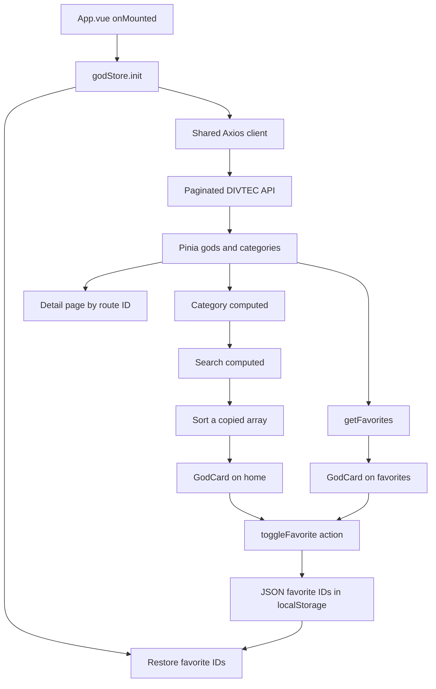

# Greek Gods

A Vue 3 and Vuetify application for exploring Greek mythology. It loads gods from the DIVTEC API, displays their portraits and details, and lets visitors search, filter, sort and save favorites. The interface and API content are in English.

This personal project covers **sequences 1–5 (steps 1–17)** of the [DEV JS Pokédex exercise](https://devjs.ch/exercices/pokedex-vuetify/e1.html). Forms, authentication and API mutations from later sequences are outside its scope.

- [Live site](https://loris-seganfredo.github.io/294-projet-dieuGrec-segalor/)
- [Favorites](https://loris-seganfredo.github.io/294-projet-dieuGrec-segalor/#/favorites)
- [Source repository](https://github.com/Loris-seganfredo/294-projet-dieuGrec-segalor)

## Purpose and audience

The application is a small reference catalog for students and visitors discovering mythology. A visitor can find a deity, read its profile and keep a personal selection in the browser. The Greek mythology data adapts the course's Pokémon examples to a different subject.

## Screenshots

Desktop, with four cards per row:


[Mobile screenshot — one card per row](docs/screenshots/home-mobile.png)

These screenshots were taken from the running application during the 3 November 2026 audit.

## Run locally

Use Node.js 22 or later. From the project directory:

```sh
npm ci
npm run dev
```

The API defaults to `https://apis.divtec.me/api/greek`. To change it, copy `.env.example` to `.env` and set `VITE_API_URL`, then restart Vite. No API key is required for this public endpoint. Variables beginning with `VITE_` are included in the browser bundle, so they must not contain secrets.

Vite starts at `http://localhost:3000/` if that port is free. Use the URL printed in the terminal. Stop the local server with `Ctrl+C`; a separate API server is not needed.

```sh
npm run build
npm run preview
npx eslint .
```

`npm run lint` also applies ESLint's automatic fixes.

## Implemented concepts

| Sequence | Application |
| --- | --- |
| 1 — Components and navigation | Responsive card grid, reusable `GodCard` with a `god` prop, home/about/detail pages and unknown-route handling. |
| 2 — Pinia | Shared gods, categories and favorites state; getters and actions; initialization from `App.vue`. |
| 3 — Axios and environment | Central Axios client, configurable API URL, loading/error states, request timeout and retry. |
| 4 — Search, filter and sort | `v-model` controls and chained computed values: category → search → alphabetical sort. |
| 5 — Favorites | Favorite IDs, toggle action, JSON/localStorage persistence, reusable cards on a dedicated favorites page and confirmation feedback. |

## How it works

- `src/stores/godStore.js` loads all API pages and exposes the shared data. Favorites store IDs, not copies of complete god objects.
- `src/pages/index.vue` derives the displayed list using computed values. Sorting operates on a copy, preserving the store's source order.
- `src/components/GodCard.vue` displays each god and opens its detail route. The heart uses `@click.stop.prevent`: `.stop` prevents propagation, while `.prevent` cancels the link's default navigation.
- `src/pages/gods/[id].vue` reads the route ID and retrieves the corresponding god from the store.
- `src/pages/favorites.vue` reuses `GodCard` and displays an empty-state message when there are no favorites.
- `src/components/GodImage.vue` displays the API portrait or a bundled Greek temple illustration when the URL is missing or the image fails to load.
- `src/composables/favoriteFeedback.js` shares confirmation state. The snackbar lives in the layout so removing the last favorite does not destroy its confirmation.

`JSON.stringify()` converts the favorite IDs into the text stored under `god_favorites`; `JSON.parse()` restores them. Favorites belong to the current browser and origin, so localhost and GitHub Pages have separate lists. They are not synchronized across devices. Obsolete IDs are removed only after a complete successful API load.

## API and data flow

The public DIVTEC Greek API was selected because it provides names, categories, descriptions, portraits and relationships for the project's subject without requiring authentication.

| Resource used | Purpose |
| --- | --- |
| `GET https://apis.divtec.me/api/greek/gods?page=1` | Load the first page and read `pagination.pages`. |
| `GET /gods?page=2`, then subsequent pages on the same API base | Load the complete catalog before publishing it to the store. |
| Image paths returned by the API, resolved against `https://apis.divtec.me` | Display available portraits. |

The list response contains `data` and `pagination`. The audit found 51 entries over three pages; this is observed API data, not a hard-coded count. Detail pages use `getGodById()` from the loaded store, so they do not make another detail request. Categories are derived from the same catalog.



API availability and content are external dependencies. No quota guarantee has been verified. Requests have a ten-second timeout; an error is displayed with a retry button. The app does not silently replace a failed API response with fictional data. Favorite storage can be unavailable or cleared by browser settings, and users are warned when persistence fails.

## Deployment and routing

Pushing `main` runs the GitHub Pages workflow. It builds with the repository base path and publishes `dist/`.

The router uses hash URLs, such as `/#/gods/1`. GitHub Pages therefore serves the same entry page for every route, and refreshing a detail page does not require server rewrite rules or an HTML file for every god.

`scripts/create-pages-redirects.mjs` generates compatibility redirects during deployment. Previous clean URLs, including `/favoris/` and `/gods/1`, lead to their hash-route equivalents. `/favoris` remains an alias for `/favorites`. An unknown route displays the application's not-found page.

## Verification checklist

- The complete API list loads; an unavailable API produces an error message with a retry button.
- Search is case-insensitive; clearing the field restores the list.
- Category filtering combines with search and A–Z/Z–A sorting.
- Clicking a card opens its detail page; clicking the heart only toggles the favorite.
- Favorite icons and counters update immediately, with brief confirmation messages.
- Favorites survive a reload and can be removed from the favorites page, including the last item.
- Home, favorites, detail and unknown routes work after direct navigation and reload.
- Browser console, production build and ESLint are checked after changes.

The [sequence 1–5 audit](docs/exam-audit.md) records the criteria checked, runtime evidence and the boundaries of this verification.

## Sources and AI assistance

God descriptions, relationships and images come from the [DIVTEC Greek API](https://apis.divtec.me/api/greek/gods). Image availability and content depend on that API.

The project uses [Vue](https://vuejs.org/), [Vue Router](https://router.vuejs.org/), [Pinia](https://pinia.vuejs.org/), [Vuetify](https://vuetifyjs.com/) and [Axios](https://axios-http.com/).

Codex assisted with implementation, debugging, documentation and verification. This records the assistance used; it does not claim that every part was written manually or that the student has already mastered every concept.

The tool used was OpenAI Codex through the desktop application. Exact model versions for earlier sessions and reliable percentages of manual versus assisted work were not recorded. Assistance included the Pinia/API integration, search and favorites, routing fixes, English interface, fallback image, tests and this documentation. The implementation was adapted to the actual Greek API, including its pagination and numeric IDs. Personal learning claims and authorship percentages must be supplied honestly by the student, rather than inferred from passing tests.

## Limits and possible improvements

- Favorites are local to one browser and site address; there is no account synchronization.
- The catalog follows the API's terminology and includes a few Roman deities. This is disclosed on the About page.
- A missing portrait uses the default illustration. The application does not supply an invented portrait for each deity.
- A future iteration could preserve search settings when returning from a profile, add a documented offline cache, or improve long-card text layouts.
- Forms and authentication belong to later course sequences and are intentionally outside this delivery.

## Personal reflection

The technical audit is complete for the documented scope. Before an oral assessment, the student still needs to explain the code and write their own account of difficulties, learning and independent contributions if requested by the teacher. Those personal statements cannot be established by an automated audit.
