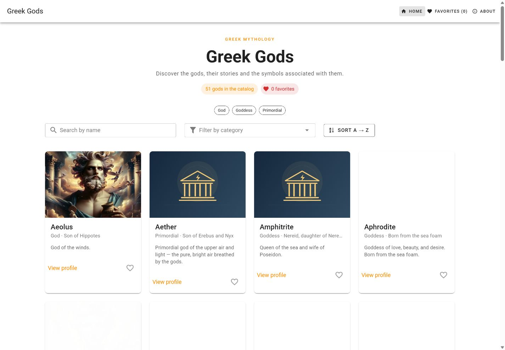
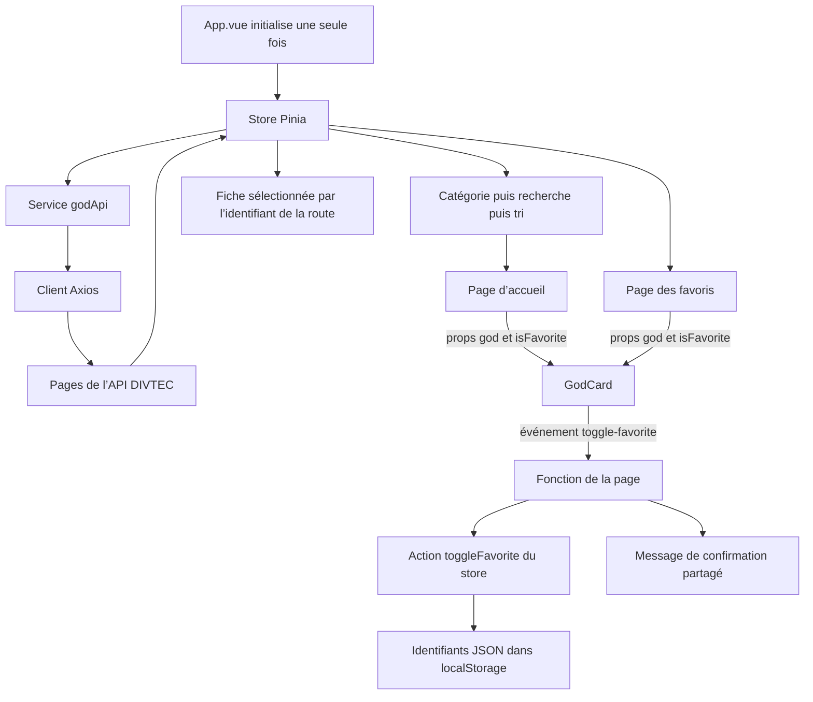

# Greek Gods — Les dieux grecs

[Application en ligne sur Vercel](https://294-projet-dieu-grec-segalor.vercel.app/) · [GitHub Pages](https://loris-seganfredo.github.io/294-projet-dieuGrec-segalor/) · [Code source](https://github.com/Loris-seganfredo/294-projet-dieuGrec-segalor)

Ce projet Vue 3 et Vuetify suit les [consignes du projet individuel évaluatif](https://tirtho.notion.site/Projet-individuel-valuatif-Application-Vue-3-Vuetify-avec-API-268e74c07f7c80e5822adb530f7a6027) et les exercices DEV JS jusqu’à la **séquence 5, étapes 1 à 17**. L’interface et les données de l’application sont en anglais. Cette documentation est en français. Les formulaires, l’authentification et la modification des données de l’API appartiennent aux séquences suivantes et ne font pas partie de cette version.

## 1. Présentation du projet

### Concept

Greek Gods est un catalogue destiné aux élèves et aux personnes qui découvrent la mythologie. Il permet de trouver une divinité, de consulter sa fiche et de conserver une sélection personnelle. L’API publique DIVTEC fournit les noms, catégories, descriptions, portraits et relations entre les dieux, sans clé API.

Le projet transpose les exemples Pokémon du cours à la mythologie grecque. Le choix de ce sujet est expliqué dans la partie 6.

### Fonctionnalités principales

- Catalogue adapté aux différentes tailles d’écran, avec portraits, noms et descriptions.
- Recherche par nom insensible aux majuscules, filtre par catégorie et tri A–Z ou Z–A.
- Fiches détaillées, page « À propos » et gestion des pages introuvables.
- Favoris avec confirmation immédiate et sauvegarde dans le navigateur.
- Indicateurs de chargement, messages d’erreur avec possibilité de réessayer et messages lorsque la liste est vide.
- Illustration de temple grec par défaut lorsqu’un portrait est absent ou ne se charge pas.
- Focus visible au clavier et couleurs contrastées pour les thèmes clair et sombre du système.

### Captures d’écran



[Version mobile](docs/screenshots/home-mobile.png) · [Thème sombre](docs/screenshots/home-dark.png)

## 2. Parcours d’apprentissage

### Ressources utilisées

La principale ressource est l’[exercice Pokédex de DEV JS](https://devjs.ch/exercices/pokedex-vuetify/e1.html), adapté à l’API des dieux grecs. Les documentations officielles de Vue, Vuetify, Pinia, Vue Router et Axios servent également de références. Les liens figurent dans la partie 7.

### Progression enregistrée

Les dates ci-dessous proviennent de l’historique Git. Elles montrent l’avancement du projet. Elles ne prouvent pas à elles seules les apprentissages personnels ni la participation aux rendez-vous hebdomadaires.

| Date | Travail enregistré |
| --- | --- |
| 22 septembre 2026 | Structure initiale du projet. |
| 20 octobre | Store Pinia, connexion des pages liste et détail, chargement de toutes les pages de l’API et configuration du chemin de base pour GitHub Pages. |
| 26 octobre | Configuration d’Axios, variables d’environnement, indicateurs de chargement et gestion des erreurs. |
| 2 novembre | Recherche, filtre par catégorie, tri alphabétique et favoris persistants. |
| 3 novembre | Interface en anglais, corrections des routes, images par défaut, vérification des exercices puis comparaison avec les consignes de l’examen. Amélioration des props/emits, séparation du service API, correction des contrastes et du focus clavier. |

Le récit personnel des ressources étudiées, des notions difficiles et des progrès reste à compléter par l’élève. Les consignes demandent des rendez-vous hebdomadaires avec l’enseignant ; leur réalisation ne peut pas être vérifiée dans le dépôt.

## 3. Outils et méthodologie

### Environnement de développement

- Vue 3, Vuetify 3, Pinia, Vue Router, Axios et Vite.
- npm pour installer les dépendances et ESLint pour vérifier le code.
- Git et GitHub pour l’historique des versions ; Vercel et GitHub Pages pour la publication.
- L’application de bureau OpenAI Codex pour l’aide au développement, à la relecture et aux tests décrite dans la partie 5.

### Installation et lancement

Utiliser Node.js 22 ou une version plus récente :

```sh
git clone https://github.com/Loris-seganfredo/294-projet-dieuGrec-segalor.git
cd 294-projet-dieuGrec-segalor
npm ci
npm run dev
```

Vite démarre normalement à l’adresse `http://localhost:3000/`. Si ce port est occupé, utiliser l’adresse affichée dans le terminal. Pour arrêter le serveur, appuyer sur `Ctrl+C`. Aucun serveur API local supplémentaire n’est nécessaire.

Pour changer l’adresse de l’API, copier `.env.example` vers `.env`, renseigner `VITE_API_URL` et redémarrer Vite. L’adresse par défaut est `https://apis.divtec.me/api/greek`. Aucune clé API n’est nécessaire. Git ignore `.env`, tandis que `.env.example` est suivi. Les variables commençant par `VITE_` sont incluses dans le code envoyé au navigateur : elles ne doivent pas contenir de secrets.

```sh
npx eslint .
npm run build
npm run preview
```

La commande `npm run lint` applique également les corrections automatiques d’ESLint.

### Composants, props et événements

`GodCard` reçoit deux props obligatoires : `god` et `isFavorite`. Il émet l’événement `toggle-favorite` avec le dieu concerné. Les pages d’accueil et de favoris traitent cet événement avec `useFavoriteFeedback()`, qui appelle l’action du store et met à jour le message de confirmation partagé. Aucun bus d’événements global n’est utilisé.

Le cœur utilise `@click.stop.prevent` : `.stop` empêche le clic de remonter à la carte et `.prevent` annule la navigation par défaut du lien. La fiche détaillée utilise la même fonction pour gérer les favoris. `GodImage` est réutilisé pour les portraits et les illustrations de remplacement. `AppFooter` reçoit son texte grâce à un slot.

### Choix de l’API et limites

| Ressource utilisée | Utilité |
| --- | --- |
| `GET https://apis.divtec.me/api/greek/gods?page=1` | Charger la première page et connaître le nombre de pages. |
| `GET /gods?page=2`, puis les pages suivantes sur la même adresse de base | Charger le catalogue complet avant de mettre à jour le store. |
| Chemins des images renvoyés par l’API, complétés avec `https://apis.divtec.me` | Charger les portraits. |

La réponse contient `data` et `pagination`. Lors de la vérification, elle contenait 51 éléments répartis sur trois pages. Ce nombre n’est pas fixé dans le code. Les catégories sont extraites des objets chargés. Les fiches utilisent `getGodById()` dans le store pour retrouver un dieu sans effectuer une nouvelle requête.

Les requêtes ont un délai maximal de dix secondes. Aucun quota garanti de l’API n’a été vérifié. Une requête qui échoue affiche un message d’erreur et un bouton pour réessayer. Si le chargement d’une page échoue, le catalogue incomplet n’est pas transmis à l’interface. Les favoris obsolètes sont supprimés uniquement après le chargement réussi de toutes les pages.

Les consignes dispensent explicitement les élèves du mode mock ou hors ligne pour **2026–2027**. En cas de panne, l’application affiche donc un message d’erreur.

### Architecture et circulation des données

| Emplacement | Rôle |
| --- | --- |
| `src/plugins/axios.js` | Client Axios partagé et configuration de l’environnement. |
| `src/services/godApi.js` | Requêtes HTTP, validation des réponses et pagination. |
| `src/stores/godStore.js` | État partagé, getters, initialisation et sauvegarde des favoris. |
| `src/pages/` | Accueil, détail, favoris, page « À propos » et page introuvable. |
| `src/components/` | Carte, image, en-tête et pied de page réutilisables. |
| `src/composables/favoriteFeedback.js` | Action sur les favoris et message de confirmation partagé. |
| `src/plugins/vuetify.js`, `src/styles/` | Couleurs des thèmes, focus clavier et animation. |



La chaîne de computed produit une vue filtrée des données du store. Le tri utilise une copie du tableau pour préserver l’ordre des données sources. Les favoris contiennent des identifiants numériques. `JSON.stringify()` les enregistre sous la clé `god_favorites` et `JSON.parse()` les restaure.

### Gestion des versions et publication

Le travail est enregistré par fonctionnalité ou correction, puis poussé sur `main`. Les consignes 2026–2027 autorisent explicitement cette branche sans imposer de branches hebdomadaires. L’historique existant a été conservé.

La compilation pour GitHub Pages utilise le chemin de base du dépôt. Les routes avec `#`, comme `/#/gods/1`, permettent l’accès direct et le rechargement d’une fiche sur un hébergement statique. Le script de déploiement redirige les anciennes adresses vers les nouvelles routes. `/favoris` reste un alias de `/favorites`.

## 4. Tests et validation

Le [rapport de vérification de l’examen](docs/assessment-audit.md) relie les critères aux vérifications effectuées et indique les éléments personnels encore à compléter. Le [premier rapport de vérification des exercices](docs/exam-audit.md) concerne uniquement les séquences 1 à 5.

Les vérifications portent sur :

- Le chargement complet de l’API réelle, la pagination, les réponses mal formées, les pannes partielles et la possibilité de réessayer.
- Les combinaisons de recherche, filtre et tri, sans modification des données sources.
- La navigation depuis une carte, les événements des favoris, la persistance après rechargement et le retrait du dernier favori.
- L’utilisation de Tab, Entrée et Espace, ainsi que le focus visible sur la navigation, les cartes, les boutons et les champs.
- Le contraste des textes et des contrôles dans les thèmes clair et sombre, y compris les messages sur fond teinté.
- L’affichage sur mobile et ordinateur, les images manquantes, les identifiants invalides et les pages inconnues.
- ESLint, la compilation de production, le déploiement et les pages publiques en fonctionnement.

Le service API, le store et les confirmations des favoris ont aussi été vérifiés avec des scripts Node isolés utilisant le véritable code, Vue et Pinia, avec une API et un stockage simulés. Ces vérifications ont été réalisées avec l’aide de Codex. Elles ne sont pas présentées comme des tests écrits ou effectués personnellement par l’élève.

## 5. Usage de l’intelligence artificielle

### Outil et contexte

OpenAI Codex a été utilisé dans l’application de bureau pour le développement, les explications, le débogage, la relecture du code, la documentation et les tests. Les versions exactes des modèles utilisés lors des premières sessions n’ont pas été enregistrées.

J’estime l’aide globale de l’IA à **80 %** pour la réalisation du projet. J’estime que **60 % du code** a été écrit par l’IA.

### Aide reçue et adaptation au projet

| Domaine | Aide apportée et adaptation au projet |
| --- | --- |
| API et store | Pagination, identifiants numériques, champs réels des dieux grecs et initialisation de Pinia. |
| Recherche et favoris | Computed chaînés, sauvegarde des identifiants et gestion d’un stockage indisponible. |
| Composants et navigation | Cartes réutilisables, props/emits explicites, routes avec `#` et clics sur le cœur indépendants de la navigation. |
| Interface et accessibilité | Textes de l’interface en anglais, image par défaut, contrastes des thèmes et focus clavier visible. |
| Validation et documentation | Vérifications de logique, tests dans le navigateur, captures et comparaison avec les consignes fournies. |

Le projet est parti d’un dépôt existant de l’élève. Le nombre de lignes ou de commits ne permet pas de distinguer précisément les contributions manuelles de l’aide reçue. Le récit personnel des contributions et des apprentissages reste à compléter.

La réussite des tests ne prouve pas la compréhension du code par l’élève. L’évaluation demande de pouvoir l’expliquer et le modifier pendant la défense orale.

## 6. Bilan personnel

### Pourquoi j’ai choisi ce sujet

Au départ, je voulais travailler sur d’autres thèmes, mais ils n’étaient plus disponibles. J’ai choisi les dieux grecs parce que c’était le dernier thème disponible qui m’intéressait.

### Apprentissages et contributions — à compléter

Il reste à décrire personnellement :

- Ce que j’ai réalisé ou compris de manière autonome.
- Les notions apprises et celles que je dois encore travailler.
- Les difficultés rencontrées, l’aide reçue et les solutions que je peux expliquer.
- Ce dont je suis fier et ce que je souhaite améliorer.

### Difficultés techniques constatées dans le projet

Le travail a porté sur la pagination de l’API, la publication dans un sous-dossier GitHub Pages, les routes invalides, la persistance des favoris, les clics sur un cœur placé dans une carte cliquable, les portraits indisponibles et les contrastes insuffisants. Il s’agit de problèmes constatés dans le projet ; leur résolution ne prouve pas à elle seule une maîtrise personnelle.

### Limites actuelles et améliorations possibles

- Les favoris appartiennent à un navigateur et à une adresse de site. Ils ne sont pas synchronisés entre les appareils.
- La disponibilité de l’API et le contenu des portraits dépendent d’un service externe. L’image par défaut remplace les portraits absents ou impossibles à charger.
- L’API contient quelques divinités romaines et fournit ses propres catégories. La page « À propos » le précise.
- Pour un catalogue beaucoup plus grand, une pagination à l’écran ou un bouton pour charger davantage de résultats pourrait limiter le nombre de cartes affichées. Le catalogue vérifié contient 51 éléments.
- Les critères de recherche pourraient être conservés au retour d’une fiche. Un cache hors ligne pourrait être ajouté par la suite si nécessaire.
- Les formulaires et l’authentification appartiennent aux séquences suivantes et ne font pas partie du périmètre demandé.

## 7. Références et sources

- [Consignes du projet individuel évaluatif, 2026–2027](https://tirtho.notion.site/Projet-individuel-valuatif-Application-Vue-3-Vuetify-avec-API-268e74c07f7c80e5822adb530f7a6027).
- [Exercices Pokédex de DEV JS, étapes 1 à 17](https://devjs.ch/exercices/pokedex-vuetify/e1.html).
- [API des dieux grecs de DIVTEC](https://apis.divtec.me/api/greek/gods), source des descriptions, relations et portraits.
- [Documentation Vue](https://vuejs.org/guide/introduction.html), [composants Vuetify](https://vuetifyjs.com/en/components/all/), [Pinia](https://pinia.vuejs.org/), [Vue Router](https://router.vuejs.org/) et [Axios](https://axios-http.com/).
- Recommandations du W3C : [contraste des textes](https://www.w3.org/WAI/WCAG22/Understanding/contrast-minimum.html), [contraste des contrôles](https://www.w3.org/WAI/WCAG22/Understanding/non-text-contrast.html), [focus visible](https://www.w3.org/WAI/WCAG22/Understanding/focus-visible.html).
- L’aide de l’IA est détaillée dans la partie 5.
